# 🧬 Modelagem e Simulação de Árvores Vasculares (CCO & TRICCO)

Este repositório contém a implementação do algoritmo **Constrained Constructive
Optimization (CCO)** para construção de árvores vasculares artificiais e sua
extensão **TRICCO (TRIfurcating CCO)**, desenvolvida para permitir
multifurcações de até três filhos por nó.

O projeto combina **modelagem geométrica**, **otimização construtiva** e
**modelagem hemodinâmica**, permitindo gerar, analisar e visualizar árvores
vasculares sintéticas em um domínio tridimensional.

---

## Objetivos

O projeto possui quatro objetivos principais:

- **Construir árvores vasculares sintéticas** utilizando o método CCO;
- **Implementar uma variante com multifurcações**, denominada TRICCO;
- **Minimizar o volume intravascular total** respeitando restrições geométricas
  e fisiológicas;
- **Comparar quantitativamente** as árvores binárias e as árvores geradas com
  suporte a trifurcações.

A implementação também permite analisar características topológicas,
geométricas e computacionais das árvores geradas.

---

#  Fundamentação

## Constrained Constructive Optimization (CCO)

O CCO é um método construtivo para geração de redes vasculares que adiciona
novos terminais progressivamente a uma árvore existente.

A cada novo terminal, o algoritmo:

1. gera um novo ponto terminal dentro do domínio;
2. verifica os segmentos existentes que podem receber uma nova conexão;
3. testa diferentes posições possíveis para a bifurcação;
4. recalcula as propriedades físicas da árvore;
5. verifica as restrições geométricas;
6. calcula o volume total da árvore;
7. seleciona a configuração viável de menor custo.

Dessa forma, a árvore é construída de maneira incremental, utilizando uma
estratégia de otimização gulosa.

---

#  Modelo físico

Cada vaso é representado como um segmento cilíndrico definido por:

- posição inicial;
- posição final;
- comprimento;
- raio;
- fluxo;
- resistência hidráulica;
- volume;
- identificador do segmento;
- identificador do segmento pai.

### Escoamento de Poiseuille

A resistência hidráulica de cada segmento é calculada utilizando a relação de
Poiseuille:

```text
R = 8 μ l / (π r⁴)
```

---

# Trabalhos

O repositório reúne três trabalhos, em que cada um evolui o anterior:

| Pasta | Trabalho | O que acrescenta |
|---|---|---|
| [`CCO1/`](CCO1/) | MiniCCO — núcleo geométrico | Crescimento da árvore em domínio circular, com conexão pelo segmento mais próximo e bifurcação no ponto médio |
| [`MiniCCO2/`](MiniCCO2/) | MiniCCO — otimização por volume | Custo passa a ser o volume total da árvore, com raios pela Lei de Murray e otimização local do ponto de bifurcação |
| [`TRICCO/`](TRICCO/) | Trabalho final — TRICCO | Permite nós com até três filhos e compara a árvore binária com a variante com multifurcações |

Cada pasta tem `include/` (cabeçalhos `.hpp`), `src/` (código C++, `Makefile` e script de visualização) e `docs/` (enunciado, relatório e slides).

---

## CCO1 — MiniCCO: núcleo geométrico

A raiz da árvore fica no ponto (0, R). A cada iteração, um novo terminal é sorteado dentro do domínio circular, respeitando distâncias mínimas em relação aos terminais, aos segmentos e à entrada. O algoritmo avalia todos os segmentos, descarta as conexões que cruzariam segmentos existentes e escolhe, de forma gulosa, o de menor custo. O segmento escolhido é dividido no ponto médio, criando uma bifurcação.

<table>
<tr><td align="center">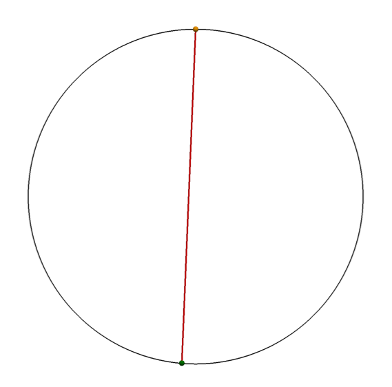<br><sub>N<sub>term</sub> = 1</sub></td><td align="center">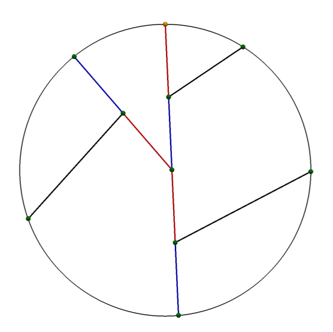<br><sub>N<sub>term</sub> = 5</sub></td><td align="center">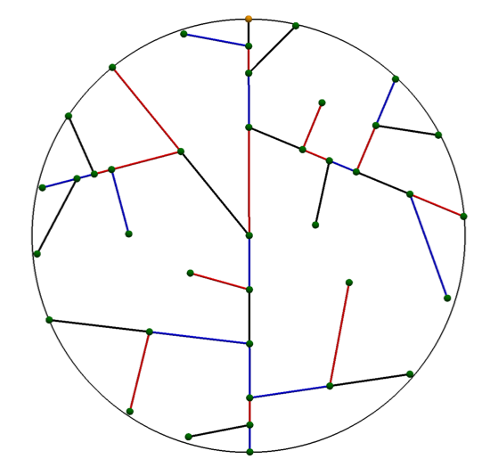<br><sub>N<sub>term</sub> = 20</sub></td><td align="center">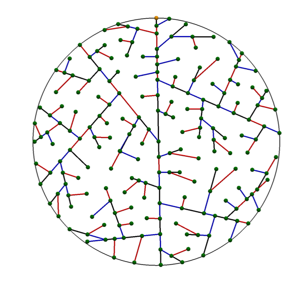<br><sub>N<sub>term</sub> = 100</sub></td></tr>
</table>

## MiniCCO2 — otimização por volume

O custo de cada candidato passa a ser o **volume intravascular total** da árvore. Para cada segmento candidato, a árvore é recalculada (fluxos, raios pela Lei de Murray, resistências e volumes), e o ponto de bifurcação é buscado numa vizinhança de 30% ao redor do ponto médio. O programa recebe o expoente γ e o parâmetro M, que define o número máximo de candidatos avaliados.

<table>
<tr><td align="center">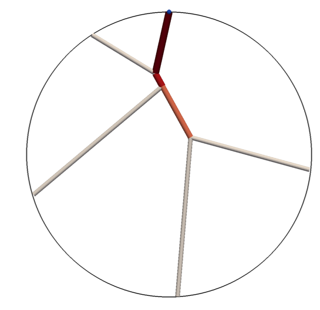<br><sub>N<sub>term</sub> = 4</sub></td><td align="center">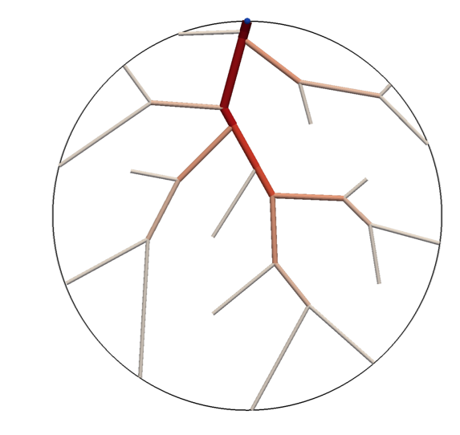<br><sub>N<sub>term</sub> = 16</sub></td><td align="center">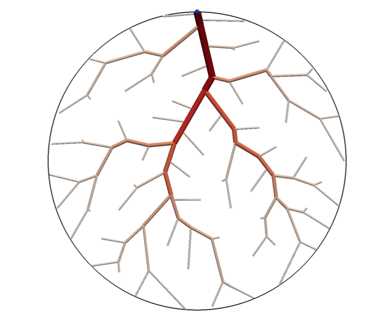<br><sub>N<sub>term</sub> = 60</sub></td><td align="center">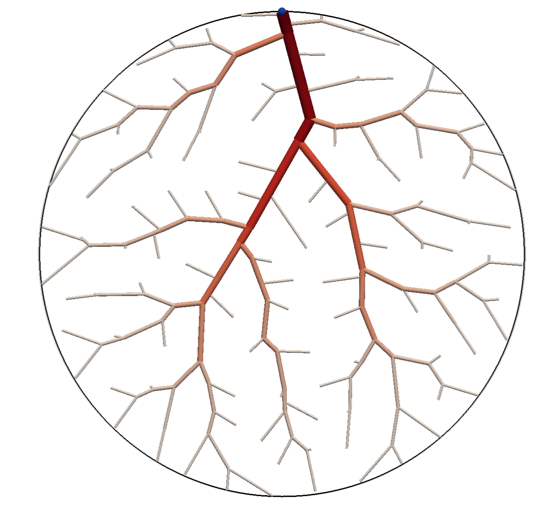<br><sub>N<sub>term</sub> = 100</sub></td></tr>
</table>

## TRICCO — multifurcações

Além da bifurcação clássica, o novo terminal pode ser **ligado diretamente a um nó que já existe**, desde que o nó tenha menos de 3 filhos e a ligação atenda aos critérios de custo e de alcance local. Os pontos azuis marcam onde ocorreram trifurcações.

<table>
<tr><td align="center">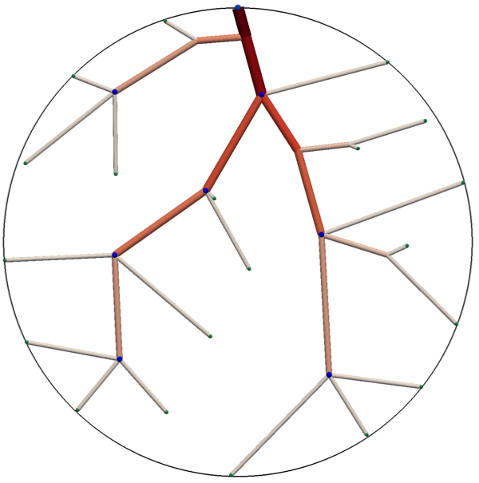<br><sub>N<sub>term</sub> = 20</sub></td><td align="center">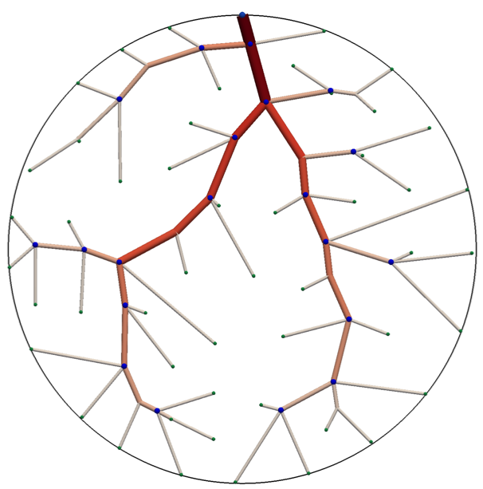<br><sub>N<sub>term</sub> = 50</sub></td><td align="center">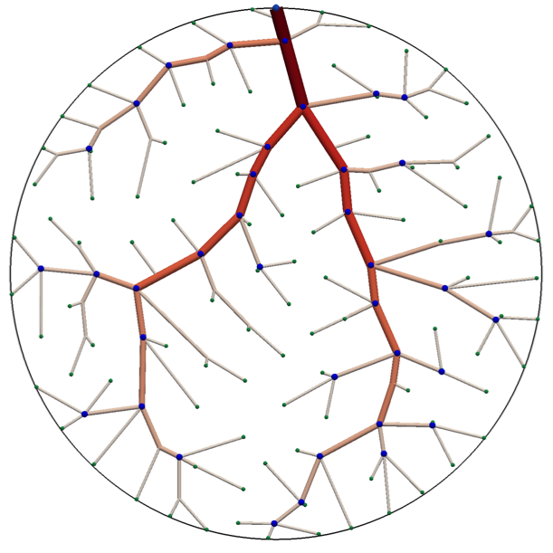<br><sub>N<sub>term</sub> = 100</sub></td><td align="center">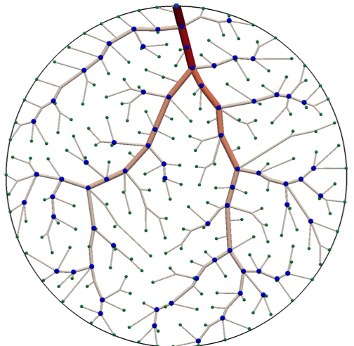<br><sub>N<sub>term</sub> = 200</sub></td></tr>
</table>

Variando o expoente de bifurcação γ, com N<sub>term</sub> = 100:

<table>
<tr><td align="center">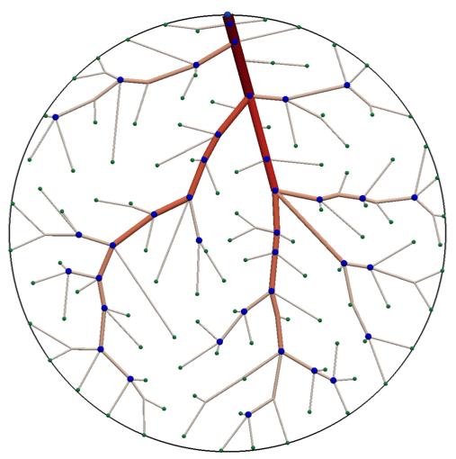<br><sub>γ = 2,7</sub></td><td align="center">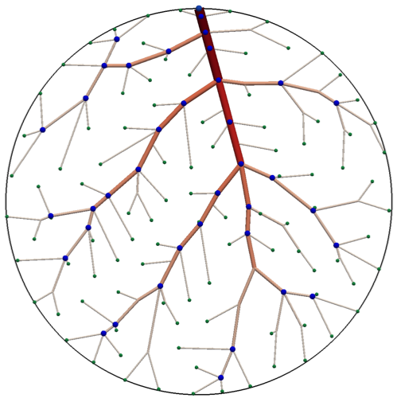<br><sub>γ = 2,55</sub></td></tr>
</table>

### Comparação entre a árvore binária e o TRICCO

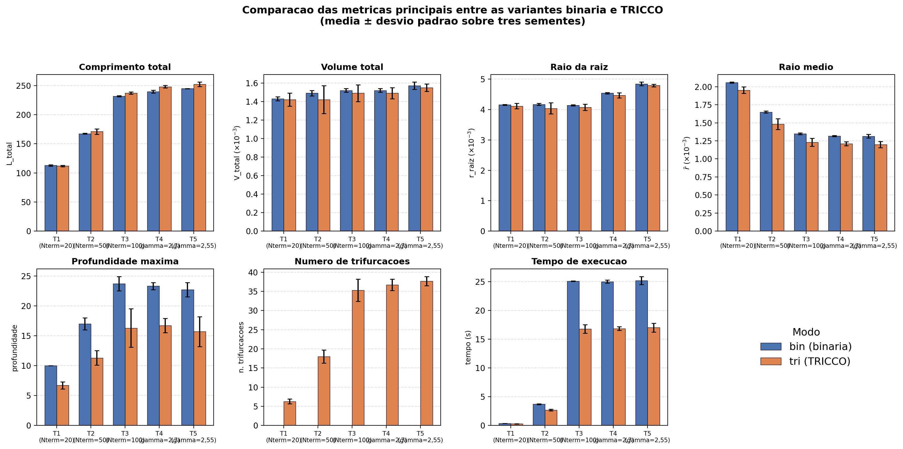

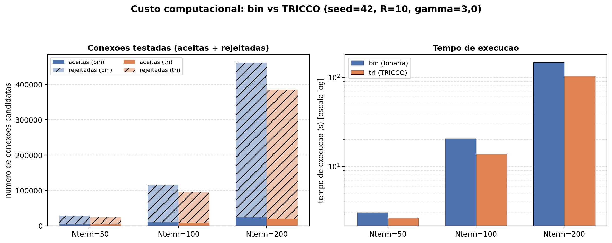

Segundo o relatório, nos experimentos realizados o TRICCO apresentou:
- volume intravascular total ligeiramente menor que o da árvore binária em todos os cenários;
- profundidade máxima menor (para N<sub>term</sub> = 100, de 23,7 para 16,3 em média);
- menor tempo de execução em todos os experimentos;
- comprimento total um pouco maior.

---

# Como executar

É preciso ter o **g++** instalado. Para a visualização, é preciso o **Python** com a biblioteca **PyVista** (`pip install pyvista`).

Todos os comandos são executados dentro da pasta `src/` do trabalho.

**CCO1**

```bash
make
./programa <numero_de_terminais> <raio>      # ex.: ./programa 10 10
python3 visualizar.py arvore.vtk
```

**MiniCCO2**

```bash
make
./minicco1 <Nterm> <R> <gamma> <M>           # ex.: ./minicco1 100 10.0 3.0 5
python3 visualizador.py arvore.vtk
```

**TRICCO**

```bash
make
./minicco1 <Nterm> <R> <gamma> <bin|tricco> <seed> [M]
# ex.: ./minicco1 100 10.0 3.0 tricco 42
python3 visualizador.py arvore.vtk raio       # também aceita: fluxo, profundidade
```

A execução gera o arquivo `arvore.vtk`, usado na visualização, além de `raio.txt`. O MiniCCO2 e o TRICCO também geram `segmentos.txt`, e o TRICCO gera ainda `execucao.log`. O `Makefile` também tem atalhos: `make run`, `make view` e, no TRICCO, `make run-tricco`.

---

# Autores

Trabalhos desenvolvidos no Departamento de Computação (DECOM) da **Universidade Federal de Ouro Preto (UFOP)**.

- Ana Paula dos Santos Tadim

Professor: Rafael Alves Bonfim de Queiroz
